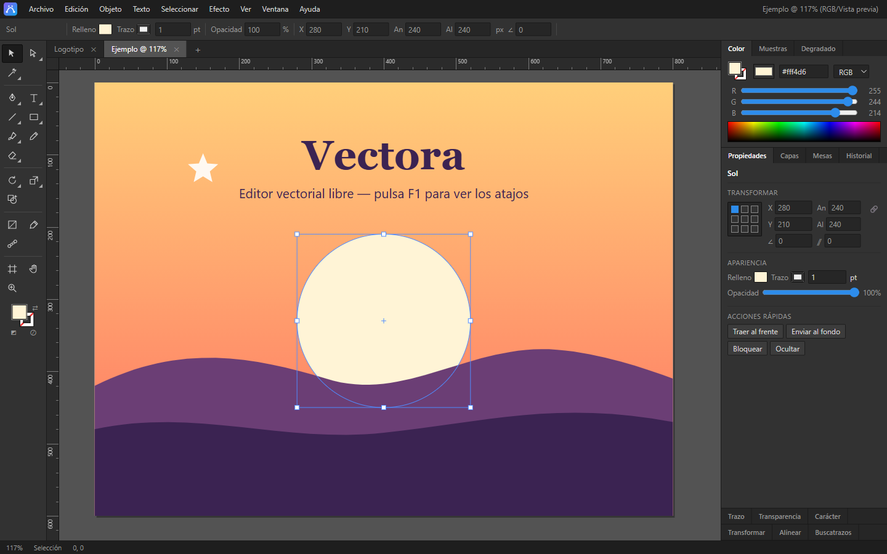
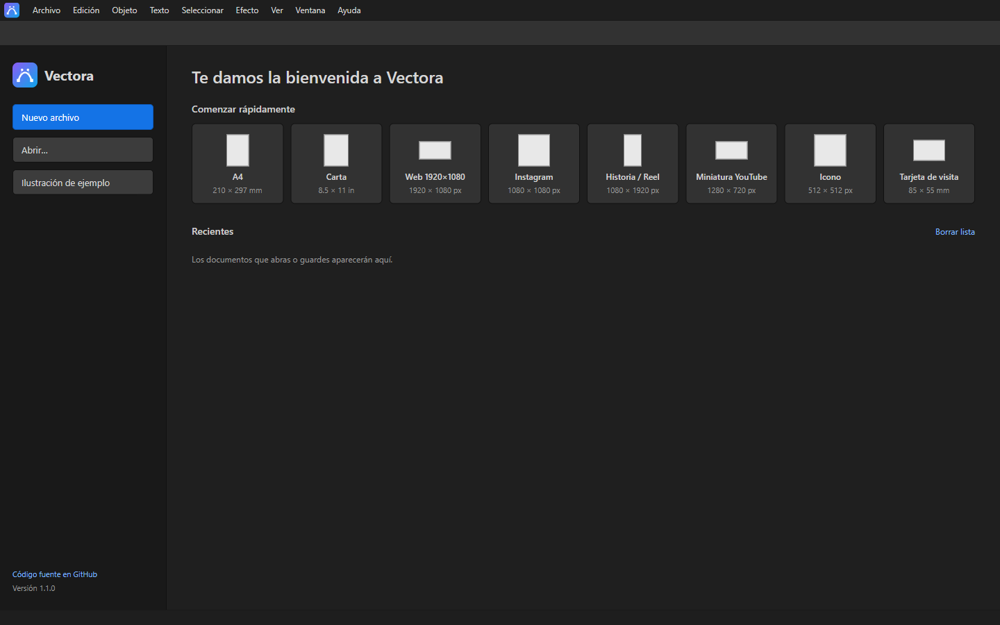

<p align="center"></p>

<h1 align="center">Vectora</h1>

<p align="center"><b>Editor de gráficos vectoriales libre y de código abierto</b>, inspirado en el flujo de trabajo de los editores profesionales.<br>
Programa de escritorio para Windows, macOS y Linux, y también aplicación web instalable.</p>

<p align="center"></p>

## Descargar

| Sistema | Archivo (en [Releases](../../releases/latest)) |
|---|---|
| **Windows** | `Vectora-Setup-x.y.z.exe` (instalador) o `Vectora-Portable-x.y.z.exe` (sin instalación) |
| **macOS** | `Vectora-x.y.z-arm64.dmg` / `-x64.dmg` |
| **Linux** | `Vectora-x.y.z-x86_64.AppImage` o `.deb` |
| **Navegador** | Versión web publicada con GitHub Pages: se puede instalar como app desde Chrome o Edge |

> Los instaladores aún no están firmados digitalmente. En Windows puede aparecer el aviso de SmartScreen: pulsa
> «Más información ▸ Ejecutar de todas formas». En macOS: clic derecho ▸ Abrir.

## Funciones

- **Interfaz profesional:** barra de herramientas con grupos desplegables, panel **Propiedades** contextual,
  **barra de tareas contextual**, paneles en pestañas plegables, **varios documentos en pestañas**, pantalla
  de inicio con plantillas y archivos recientes, menú contextual, **temas** (oscuro, medio y claro),
  **Preferencias**, **atajos de teclado personalizables** e interfaz en **español o inglés**.
- **Herramientas (más de 45):** selección, selección directa, selección de grupos, varita mágica, lazo,
  pluma, **curvatura**, convertir punto de ancla, texto, texto de área, texto en trazado, línea, arco,
  espiral, cuadrículas, rectángulo, elipse, polígono, estrella, pincel, pincel de manchas, lápiz,
  **suavizar**, **borrador de trazados**, **unir**, borrador, tijeras, cuchillo, rotar, reflejar, escala,
  distorsionar, **transformación libre** (distorsión libre y perspectiva), **anchura**, creador de formas,
  **bote de pintura interactiva**, degradado (editable sobre el objeto), cuentagotas, fusión, mesa de
  trabajo, mano y zoom.
- **Documento:** ajustes de Móvil, Web, Imprimir, Cine y vídeo, Redes sociales e Ilustración; unidades,
  orientación, sangrado, **varias mesas de trabajo** y **modo de color RGB o CMYK**.
- **Precisión:** guías inteligentes con **etiquetas de medida**, ajuste a bordes, centros y puntos de
  ancla, reglas con origen ajustable y guías (también creadas desde objetos), cuadrícula, Transformar con
  punto de referencia, **Transformar cada uno**, **objeto clave** y **distribuir espaciado**, modo aislamiento.
- **Trazados:** **Buscatrazos completo** (unificar, menos frente, intersecar, excluir, dividir, recortar,
  combinar, cortar, contorno, menos fondo), **esquinas en vivo**, unir, simplificar, contornear trazo,
  desplazar trazado, trazado compuesto, máscara de recorte y Transformar de nuevo.
- **Apariencia:** panel **Apariencia** con **efectos en vivo** editables (fruncir y engordar, retorcer,
  zigzag, rugosidad, redondear esquinas, **15 deformaciones de envolvente**, sombra, desenfoque),
  Expandir apariencia, **estilos gráficos**, **símbolos** y **motivos** (con biblioteca).
- **Pinceles:** caligráficos, de arte y de dispersión, pinceles propios a partir de la selección y
  **perfiles de anchura variables**.
- **Texto:** Carácter (fuentes del sistema, **OpenType**, subrayado), **Párrafo** (justificar, sangrías,
  espacios), **texto enlazado** entre cuadros, **estilos de párrafo y de carácter**, **Glifos**,
  **buscar y reemplazar**, revisión ortográfica y Crear contornos.
- **Color:** Color (RGB, HSB, **CMYK**), muestras, **colores globales y planos** con matices, Degradado,
  Transparencia, **Volver a colorear ilustración** con rueda de armonía y Editar colores.
- **Capas:** miniaturas, opciones de capa (plantilla, no imprimible), recopilar, liberar a capas, fusionar.
- **Automatización:** **consola de scripts** en JavaScript con ejemplos; cada script se deshace de una vez.
- **Imagen:** Calco de imagen (fotografía, colores, grises, blanco y negro, silueta).
- **Historial** con nombre de cada paso, deshacer por documento y autoguardado de la sesión.

### Importar y exportar

| | Formatos |
|---|---|
| **Abrir / Colocar** | SVG, PDF, AI (compatible con PDF), PNG, JPEG, WebP, GIF, BMP, AVIF; arrastrar y soltar o pegar |
| **Exportar como** | PNG, JPEG y WebP (72/150/300 ppp o personalizado, fondo, suavizado, calidad), SVG (decimales, CSS interno, minificado, adaptable), PDF vectorial (sangrado y marcas de corte) |
| **Varias mesas** | PDF de varias páginas o un archivo por mesa en ZIP |
| **Exportar para pantallas** | ZIP con varias escalas: Web (1x, 2x + SVG), iOS (1x, 2x, 3x), Android (mdpi … xxxhdpi) o personalizado |
| **Guardar** | SVG con capas, mesas de trabajo, guías, muestras, colores globales, estilos, pinceles, unidades y sangrado |
| **Imprimir** | una página por mesa, tamaño de papel, marcas de recorte y de registro, sangrado |

Pulsa **F1** dentro del programa para ver todos los atajos de teclado.

<p align="center"></p>

## Desarrollo

Requisitos: [Node.js](https://nodejs.org) 20 o superior.

```bash
npm install          # dependencias (Electron y librerías PDF)
npm start            # abre el programa de escritorio
npm run web          # sirve la versión web en http://localhost:8080
npm run check        # comprueba la sintaxis y las referencias
npm run dist:win     # crea el instalador de Windows en dist/
```

- Las pruebas de geometría están en `tests.html`: ábrelo en el navegador con `npm run web`.
- `npx electron scripts/smoke-electron.js archivo.svg` arranca el programa, abre el archivo y comprueba la exportación e importación de PDF.

La interfaz es HTML, SVG y JavaScript sin dependencias ni compilación: `index.html` funciona tal cual en el navegador.

### Publicar una versión

1. Cambia `version` en `package.json` y en `js/app.js` (`APP_INFO`).
2. Crea y sube la etiqueta:
   ```bash
   git tag v1.0.0
   git push origin v1.0.0
   ```
3. GitHub Actions compila los instaladores de Windows, macOS y Linux y los publica en **Releases**.

La versión web se publica sola en **GitHub Pages** con cada cambio en `main`. Actívalo una vez en
*Settings ▸ Pages ▸ Source: GitHub Actions*.

### Estructura

| Ruta | Contenido |
|---|---|
| `index.html`, `css/` | interfaz |
| `js/core.js`, `js/units.js` | estado, vista, capas, historial y unidades |
| `js/geometry.js`, `js/pathfinder.js`, `js/pathops.js`, `js/builder.js` | geometría, operaciones booleanas, de trazado y creador de formas |
| `js/selection.js`, `js/tools.js`, `js/pentools.js`, `js/nodetools.js`, `js/moretools.js` | selección y herramientas |
| `js/text2.js`, `js/trace.js`, `js/effects2.js` | texto de área y en trazado, contornos, calco de imagen y efectos |
| `js/docs.js`, `js/artboards.js`, `js/isolation.js` | pestañas e inicio, mesas de trabajo y modo aislamiento |
| `js/panels*.js`, `js/menus.js`, `js/dialogs.js`, `js/newdoc.js`, `js/guides.js` | paneles (Propiedades, Transformar, Historial…), menús y diálogos |
| `js/files.js`, `js/importer.js`, `js/exporter.js` | archivos, importación y exportación |
| `js/fxlive.js`, `js/brushes.js`, `js/gstyles.js` | efectos en vivo, Apariencia, pinceles, anchura, deformar y estilos gráficos |
| `js/drawtools.js`, `js/liveshapes.js`, `js/gradannot.js` | curvatura, suavizar, borrador de trazados, unir, transformación libre, pintura interactiva, esquinas en vivo y degradado sobre el objeto |
| `js/typo.js`, `js/colorx.js` | párrafo, texto enlazado, OpenType, glifos, estilos de texto · CMYK, colores globales, volver a colorear e impresión |
| `js/symbols.js`, `js/layers2.js`, `js/objectops.js`, `js/pathfinder2.js`, `js/taskbar.js` | símbolos y motivos, capas, alinear y seleccionar, buscatrazos, barra de tareas |
| `js/prefs.js`, `js/appx.js`, `js/i18n.js` | preferencias y temas, atajos, scripts, actualizaciones e idioma |
| `js/app.js`, `sw.js`, `manifest.webmanifest` | integración como aplicación (escritorio y PWA) |
| `electron/` | programa de escritorio |

## Contribuir

Las contribuciones son bienvenidas. Lee [CONTRIBUTING.md](CONTRIBUTING.md) y abre un *issue* o una *pull request*.

## Licencia

[MIT](LICENSE). Usa [jsPDF](https://github.com/parallax/jsPDF), [svg2pdf.js](https://github.com/yWorks/svg2pdf.js) y [opentype.js](https://github.com/opentypejs/opentype.js) (MIT),
[PDF.js](https://github.com/mozilla/pdf.js) (Apache 2.0) e [imagetracerjs](https://github.com/jankovicsandras/imagetracerjs) (dominio público). Vectora es un proyecto independiente, sin relación con Adobe.

---

**English:** Vectora is a free, open-source vector graphics editor with a professional workflow: pen, curvature and
node editing, live corners, a complete Pathfinder, shape builder and live paint, live effects with an Appearance panel,
envelope warps, graphic styles, symbols and patterns, calligraphic/art/scatter brushes and variable width strokes,
area and threaded type with paragraph and character styles, OpenType and glyphs, global and spot colors, CMYK mode,
Recolor Artwork, multiple artboards and document tabs, smart guides, scripting, customizable shortcuts, and
import/export of SVG, PDF, AI, PNG, JPEG and WebP. It ships as a desktop app for Windows, macOS and Linux (Electron)
and as an installable web app. The interface is available in **English and Spanish** (Preferences ▸ Language). MIT licensed.
